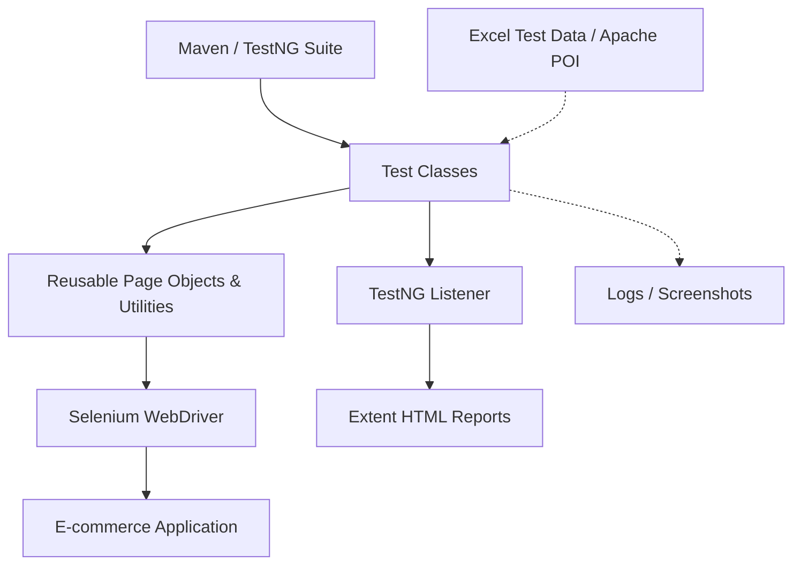

**EcommerceHub V9**
Hybrid Test Automation Framework | Selenium · Java · TestNG · Maven
A modular UI test automation project for e-commerce workflows, combining page-based test design, data-driven testing, cross-browser execution, and rich test reporting.

Explore the Source · [**Test Suite**](testng.xml) · [**Maven Configuration**](pom.xml) · [**Generated Reports**](reports/)

📖 Overview
EcommerceHub V9 is a Java-based hybrid UI automation framework created to validate common e-commerce user journeys. It uses Selenium WebDriver to interact with the application, TestNG to organize and execute tests, and Maven to manage dependencies and the build lifecycle.

The project demonstrates practical automation engineering techniques, including reusable browser interactions, structured test cases, Excel-based data support, test groups, cross-browser suites, logging, and HTML execution reports.
Project scope: This repository is an automated testing framework, not the source code for an e-commerce storefront. The test application must be accessible when the tests run.

✨ Key Capabilities
Capability	Implementation / purpose
🧪 UI automation	Selenium WebDriver automates e-commerce user workflows.
🧩 Hybrid design	Combines page-oriented automation, reusable test utilities, and data-driven approaches.
🌐 Cross-browser execution	The TestNG suite defines Chrome, Firefox, and Edge runs.
⚡ Parallel test suites	testng.xml declares parallel="tests" with thread-count="5".
🗂️ Test organization	TestNG suite configuration, test classes, and execution groups.
📊 HTML reporting	Extent Reports integration through utilities.ExtentReportManager.
📸 Failure investigation	Repository includes screenshot artifacts for debugging test failures.
📑 Data support	Apache POI dependencies support Excel-based test data.
📝 Logging	Log4j dependencies and a logs/ directory support diagnostics.
📦 Dependency management	Maven pom.xml provides the dependency configuration.

🏗️ Framework Architecture

Typical execution flow: A test suite selects the required browser and test classes → TestNG orchestrates execution → Selenium interacts with the e-commerce application → assertions validate expected behavior → listeners and utilities provide evidence for troubleshooting.
🧰 Technology Stack
The following versions are declared in the current repository's pom.xml:
Tool	Version / usage
Java	Programming language (JDK version not pinned in the POM)
Selenium Java	4.51.0
TestNG	7.12.0
Maven Compiler Plugin	3.16.0
Maven Surefire Plugin	3.5.4
Extent Reports	5.1.2
Apache POI / POI OOXML	6.0.0
Apache Commons Email	1.6.0
Log4j API / Core / SLF4J implementation	2.26.1
Git & GitHub	Source control and repository hosting

📁 Project Structure
Below is a simplified view of the folders and files visible at the repository root:
EcommerceHubV9/
├── src/
│   └── test/                     # Test automation source
├── testData/                     # Test data files
├── screenshots/                  # Screenshot artifacts
├── reports/                      # HTML execution reports
├── logs/                         # Execution logs
├── test-output/                  # TestNG output
├── target/                       # Maven-generated output
├── .settings/                    # IDE settings
├── pom.xml                       # Dependencies and Maven plugins
└── testng.xml                    # Suite, browsers, groups, listeners
Note: The diagram shows the confirmed top-level layout. Generated output directories may differ by machine and should generally be excluded from version control.

✅ Automated Test Coverage
The current testng.xml references the following classes across the configured browser runs:
Test class	Scenario
TC01_LaunchApplication	Launch application and verify initial access
TC02_Login	Login workflow
TC02_Login2_DataDriven	Data-driven login checks
TC03_AddToCart	Add an item to the shopping cart
TC04_CompletePurchase	Complete a purchase workflow
TC05_AddToWishList	Add an item to a wishlist
TC06_AddAffiliate	Affiliate-related workflow

Coverage at a glance: application launch · login · data-driven login · cart · checkout/purchase · wishlist · affiliate.

These are the scenarios configured in the suite; this is not a claim that every test currently passes in every environment.

🚀 Getting Started
1. Prerequisites
Install and configure:
- Java JDK compatible with the repository dependencies and your environment.
- Apache Maven (mvn accessible from the terminal).
- Git.
- At least one supported browser: Chrome, Firefox, or Edge.
- An IDE such as Eclipse or IntelliJ IDEA (optional).
- Access to the target e-commerce application configured in your test code.
Verify the local tools:
java -version
mvn -version
git --version

2. Clone the repository
git clone https://github.com/Elakiya1505/EcommerceHubV9.git
cd EcommerceHubV9

3. Import dependencies
mvn clean test-compile
If working in an IDE, import the repository as an existing Maven project and refresh Maven dependencies.

4. Review execution settings
Open [`testng.xml`](testng.xml) before running. The current suite specifies:
<suite thread-count="5" name="Suite" parallel="tests">
    ...
    <test name="chromeTest">
        <parameter name="os" value="windows"/>
        <parameter name="browser" value="chrome"/>
        ...
    </test>
    ...
</suite>
Important for macOS/Linux: The existing configuration uses os="windows" for all three browser tests. Update the OS value where needed if your browser setup uses this parameter. Check browser initialization, application URLs, test credentials, and local file paths before starting a run.

5. Execute the suite
mvn clean test
Maven's Surefire plugin is configured to use testng.xml. The suite currently selects the regression group; other group entries are present but commented out.

To execute a single browser, temporarily retain only the desired <test> block in testng.xml, or create a separate TestNG suite file for that browser and run:
mvn test -Dsurefire.suiteXmlFiles=chrome-testng.xml
The command above assumes you have created a chrome-testng.xml file; it is an example, not a file currently verified in this repository.

🌐 Cross-Browser & Parallel Execution
TestNG test	Browser parameter	OS parameter in current XML
chromeTest	chrome	windows
firefoxTest	firefox	windows
edgeTest	edge	windows

TestNG's parallel="tests" setting permits those browser suites to execute concurrently, subject to available resources and proper WebDriver isolation. For reliable parallel tests, each execution thread should maintain its own driver instance and independent state.

📊 Reports, Logs & Screenshots
The suite registers an Extent Reports listener:
<listeners>
    <listener class-name="utilities.ExtentReportManager"/>
</listeners>

After a run, inspect the relevant output folders:
- reports/ — Extent HTML reports.
- test-output/ — TestNG-generated test results.
- screenshots/ — captured screenshots, when generated by the framework.
- logs/ — diagnostic log output.

Open a generated .html report in a browser to review execution results. Report filenames may contain timestamps.
Screenshot path tip for macOS 🍎
If screenshot capturing or embedding fails on macOS, verify that file paths use platform-friendly separators. For example, replacing a Windows-specific "\\screenshots\\" segment with "/screenshots/" in the relevant BaseClass.java path construction can fix path issues. Prefer Paths.get(...) or File.separator for portable code.

📑 Data-Driven Testing
The project includes:
- An explicitly configured TC02_Login2_DataDriven test class.
- A testData/ directory.
- Apache POI and POI OOXML dependencies for Excel file support.
This setup supports separating test inputs from test logic. Before running tests on another machine, confirm that the Excel files exist at the expected location and that any referenced spreadsheet tabs, column headings, and credentials match the test implementation.

🧪 TestNG Groups
The current suite enables the regression group:
<groups>
    <run>
        <!--<include name="sanity"/>-->
        <include name="regression"/>
        <!--<include name="datadriven"/>-->
    </run>
</groups>

To switch test selections, update the group entries in testng.xml. Actual execution depends on the Test(groups = ...) annotations in the source classes.

🔧 Troubleshooting
Issue	What to check
Browser does not launch	Installed browser, WebDriver setup, driver/browser compatibility, OS configuration.
Tests run on the wrong environment	Base URL and configuration values in the test source.
No tests execute	TestNG groups, suite XML path, test annotations, and class names.
Screenshot missing on Mac	Windows-style path separators; use platform-neutral path construction.
Element click intercepted	Add a targeted explicit wait; verify overlays and element clickability.
Tests interfere during parallel runs	Use isolated WebDriver instances and avoid shared mutable test state.
Missing Excel test data	File location, workbook and worksheet names, and runtime working directory.
Report not generated	Listener registration, filesystem permissions, and report output path.

💡 Engineering Practices Demonstrated
This project is useful as a QA automation portfolio project, demonstrating the ability to:
- Organize reusable Java-based Selenium tests.
- Configure TestNG suites for grouping and browser coverage.
- Manage dependencies and execution with Maven.
- Incorporate external test data into automated checks.
- Produce structured execution reports and supporting diagnostics.
- Troubleshoot cross-platform path and browser execution issues.

🗺️ Potential Enhancements
The following are ideas for future work, not features claimed to exist today:
- [ ] Add a GitHub Actions workflow for automatic test execution.
- [ ] Introduce environment-specific configuration and secure secrets handling.
- [ ] Use cross-platform path utilities throughout the framework.
- [ ] Add a stable headless test profile for CI environments.
- [ ] Keep reproducible example test data while excluding confidential records.
- [ ] Add screenshots or sample test reports to a dedicated documentation folder.
- [ ] Add badges for actual CI status once a workflow is configured.

👩‍💻 Maintainer
Elakiya1505

🔗 Repository: github.com/Elakiya1505/EcommerceHubV9
Built to explore practical, maintainable UI automation for real-world e-commerce scenarios.

